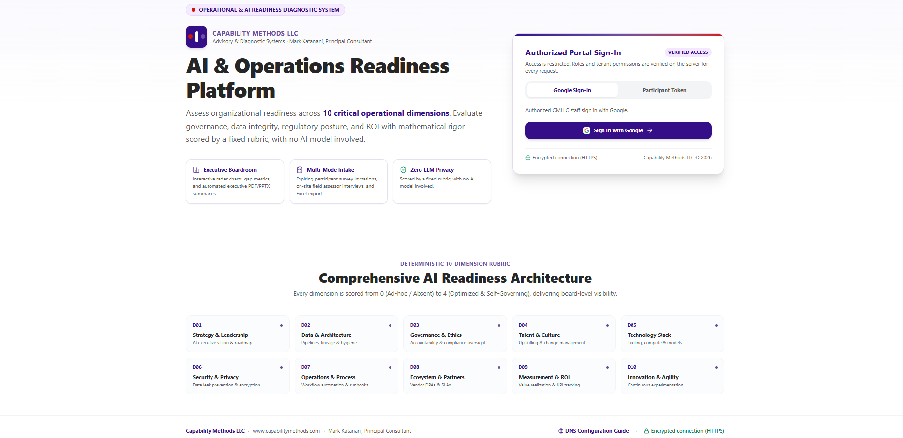
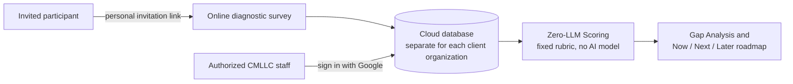

# Tier 1 AI & Operations Readiness Diagnostic: Platform V1

**Capability Methods LLC** · AI and operations advisory for growing businesses · Wesley Chapel, Florida

## What it is

Platform V1 is the online version of our **Tier 1 AI & Operations Readiness Diagnostic**. We built it to make the diagnostic faster for the people who take part and clearer for the owners who receive the results. Built by Capability Methods; first release published 2026-10-25.

The diagnostic answers one question for an owner-managed business: *where do we really stand, and what should we fix first?* In 3 weeks it gives you:

- A scored picture of your operations and AI readiness
- 5 to 8 interviews with your team and a written Gap Analysis
- An executive readout
- A Now / Next / Later roadmap you can use with or without us

## How it works

- **Invitation only.** Invited participants take the diagnostic survey online through a personal invitation link.
- **Zero-LLM Scoring:** scored by a fixed rubric, with no AI model involved.
- **Staff access.** Authorized CMLLC staff sign in with Google.
- **Your answers stay yours.** Answers are stored in a cloud database protected by access rules, kept separate for each client organization.
- **Offline option on request:** assessments can be run in person on a CMLLC-managed laptop without an internet connection.

## Why we built it this way

Many businesses are asked to put their data into AI tools before they know where they stand. We wanted the readiness diagnostic itself to be simple, private and explainable: the same answers always give the same score, and every score traces back to a written rubric.

## Who is behind it

Mark Katanani, Principal Consultant. 25+ years leading technology transformation in large enterprises, including Infosys, Wells Fargo, SAIC and Sun Microsystems. TOGAF/DFSS, Lean Six Sigma Master Black Belt, SAFe RTE, and U.S. patent holder (AI/ML defect prediction).

## Talk to us

The platform is invitation-only. To see whether the diagnostic fits your business, **[book a 20-minute call](https://calendly.com/capabilitymethods)**.

- Website: [capabilitymethods.com](https://www.capabilitymethods.com) · Services: [services.capabilitymethods.com](https://services.capabilitymethods.com)
- Email: info@capabilitymethods.com · Phone: (813) 816-0186

This repository is a showcase only. It contains no platform source code and no client data. © 2026 Capability Methods LLC.
