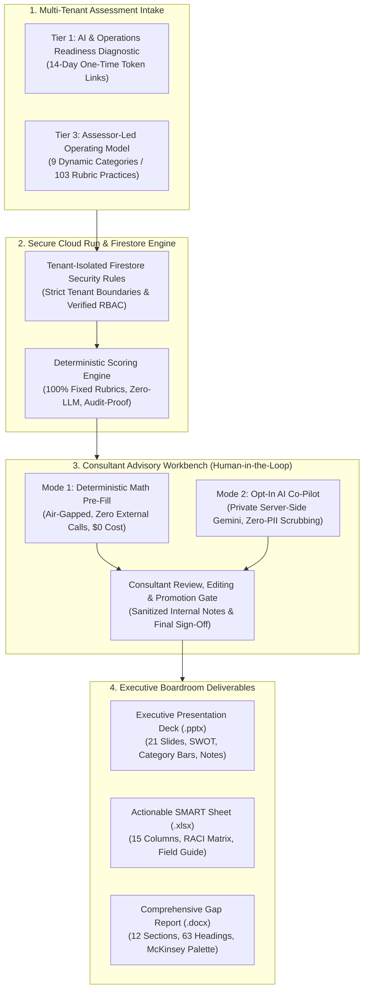

# Capability Methods LLC · Enterprise Cloud Diagnostic & Advisory Platform

**AI, Cloud & Operations Readiness Platform (Platform V1 & V2)**  
Enterprise Advisory & Diagnostic Infrastructure · Capability Methods LLC · Wesley Chapel, Florida  
🌐 **Live Platform:** [platform.capabilitymethods.com](https://platform.capabilitymethods.com) · 🏢 **Corporate Site:** [capabilitymethods.com](https://www.capabilitymethods.com)

---

## Executive Overview

The **Capability Methods Cloud Assessment & Advisory Platform** is an enterprise-grade diagnostic engine built to help business owners, transformation sponsors, and technology executives evaluate their operational maturity and AI readiness with mathematical rigor and publication-grade advisory deliverables.

Unlike generic survey tools or ungrounded AI chat wrappers, the platform pairs **100% audit-proof, deterministic mathematical scoring** with an **opt-in enterprise AI co-pilot**, generating an end-to-end consulting engagement triumvirate in seconds:

1. **Boardroom Executive Presentation Deck (`.pptx`):** 21 widescreen slides, 2×2 SWOT matrix, category delta bars, masked stakeholder quote grid, 6 deep-dive gap themes, and structured presenter speaker notes on every slide.
2. **Actionable SMART Remediation Matrix (`.xlsx`):** 15-column remediation backlog, auto-filtered, frozen headers, RACI matrix assignment, 90-day horizon phasing (Days 1–30, 31–60, 61–90), and a dedicated Field Guide.
3. **Comprehensive Gap Analysis Findings Report (`.docx`):** 12-section, 63-heading publication-grade Word report incorporating Crawl–Fly, 6C Continuous Delivery, ITSM, and ISO/IEC 42001 & NIST AI RMF frameworks.

---

## Architectural Highlights

---

## Key Capabilities

### 1. Dual-Tier Multi-Tenant Assessment
* **Tier 1 (Self-Service or Assessor-Led):** Rapid 10-dimension diagnostic for business owners and leadership teams, distributed via secure, one-time 14-day `?token=` links that require zero client password friction.
* **Tier 3 (Assessor-Led Deep Dive):** Comprehensive 9-category, 103-rubric item operating model assessment covering Product Centricity, Architecture, Lean Governance, Value Stream Flow, and AI Engineering Readiness.

### 2. Two-Mode Synthesis Engine (Consultant Co-Pilot)
* **Mode 1: Deterministic Math (Air-Gapped / Zero-LLM) [Default]:** Synthesizes advisory themes, operational business impacts, recommended remediation actions, and 3-horizon roadmaps entirely through mathematical scoring algorithms and codified rubric gap definitions. Zero third-party data transmission, audit-proof, and $0 cost.
* **Mode 2: Opt-In AI Co-Pilot (Human-in-the-Loop):** Private server-side Gemini 2.5 synthesis for clients seeking narrative enrichment. Inbound context is scrubbed of all personal names and email addresses, stakeholder quotes are strictly attributed as `"Anonymous Stakeholder"`, and confidential consultant notes are forced to empty string.

### 3. McKinsey-Grade Visual Restraint & Brand Polish
* **Universal Brand Mark:** Official transparent Capability Methods LLC logo embedded directly across web navigation, Word cover pages, and Excel worksheets.
* **3-Color Executive Palette:** Restricted strictly to Deep Indigo (`#350F88`), Executive Charcoal (`#262626`), and Soft Lavender Tint (`#F3F0FA`).
* **Practitioner Prose:** Zero emojis, zero em-dashes, and zero AI filler clichés. Every sentence is written for senior executive credibility.

---

## Security & Privacy Guardrails

* **Tenant Data Isolation:** Multi-tenant Firestore security rules fail closed; client organizations and survey responses are completely segregated cryptographically and logically.
* **Zero Client PII to LLMs:** Under no circumstance is raw client respondent data, personal names, or email addresses passed to external language models.
* **Consultant Sovereignty:** Machine-generated output is strictly treated as an initial draft. Client release is gated by mandatory Principal Consultant review and explicit "Promote to Final" authorization.

---

## Leadership & Methodology

**Mark Katanani**  
*Principal Consultant & Founder · Capability Methods LLC*

25+ years leading enterprise technology transformation, operational excellence, and mission-critical cloud delivery across global institutions including Infosys, Wells Fargo, SAIC, and Sun Microsystems.

* **Credentials:** TOGAF Enterprise Architect, Design for Six Sigma (DFSS), Lean Six Sigma Master Black Belt (LSS MBB), SAFe Release Train Engineer (RTE).
* **Innovation:** U.S. Patent Holder in AI/ML-driven software defect prediction and quality telemetry.

---

## Engagement & Booking

Platform access is invitation-only for enterprise client engagements and partner assessments.

* 🌐 **Live Platform Sign-In:** [platform.capabilitymethods.com](https://platform.capabilitymethods.com)
* 📅 **Executive Briefing:** [Book a 20-minute consultation on Calendly](https://calendly.com/capabilitymethods)
* ✉️ **Inquiries:** info@capabilitymethods.com · 📞 **Direct:** (813) 816-0186
* 🏢 **Corporate Services:** [services.capabilitymethods.com](https://services.capabilitymethods.com)

---

© 2026 Capability Methods LLC. All rights reserved. This repository serves as an architectural showcase and public overview; it contains zero confidential client data and zero proprietary platform source code.
